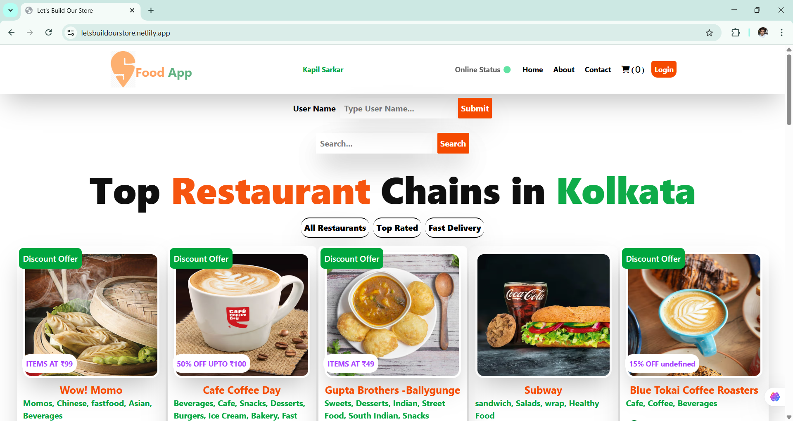
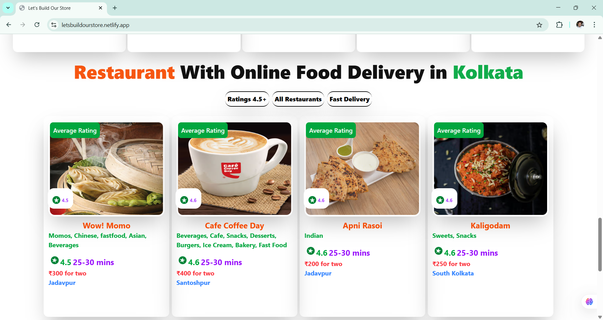
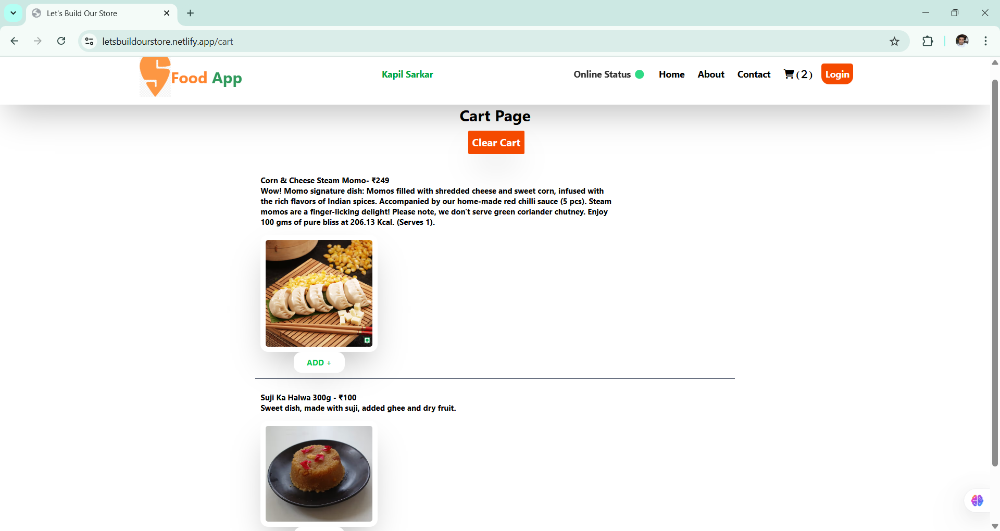
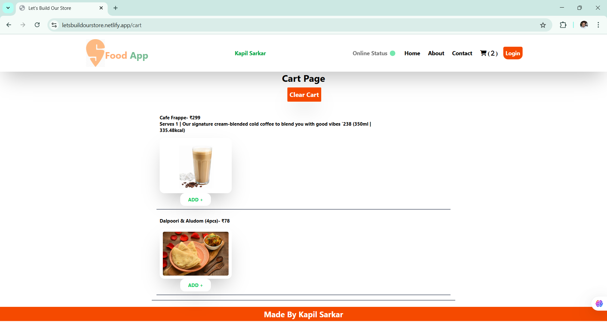
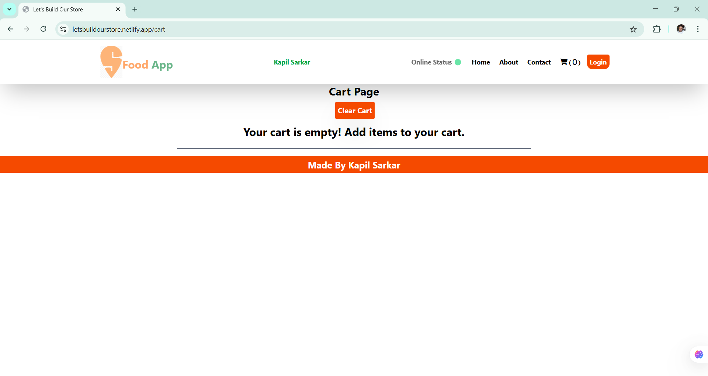

## 🙏 NAMASTE ❤️ REACT WEB SERIES BY AKSHAY SAINI 🚀 SIR

## Namaste React Course from Zero to Hero 🚀 by Akshay Saini(Founder of NamasteDev). This repository contains Codes, Assignments, Assignment Solution of this course.

---
##  Projects
| No. | Project Name   | Folder Link  | Live Link |
|-----|----------------|---------------|---------------|
| 1   | Food App       | [Click Here](https://github.com/kapilsarkar/NAMASTE--REACT/tree/main/FOOD-APP) | [Link](https://foodappkolkata.netlify.app/)  |
| 2   | YouTube Clone  | [Click Here](https://github.com/kapilsarkar/NAMASTE--REACT/tree/main/YOUTUBE-CLONE)   | [Link](https://youtubeclonekapil.netlify.app/)   |
| 3   | NetFlix GPT  | [Click Here](https://github.com/kapilsarkar/PROJECT-REPO/tree/main/REACT-JS%20PROJECTS/NETFLIX-GPT)   | [Link](https://kapilmoviebaseproject.netlify.app/)   |

---
## 🍉 Food-App :

### Created a Food-App 🍉 🍉 from scratch using React and Tailwind CSS 🚀

  ❄️ ➡️[LIVE LINK](https://foodappkolkata.netlify.app/)

  📁 ➡️[FOLDER LINK](https://github.com/kapilsarkar/NAMASTE--REACT/tree/main/FOOD-APP)
  
---

 
 
 
 
 
---

## 🪶 CONTENTS :

### 📚 EPISODE-01 (INCEPTION) 📗 :

---

Introduction to foundational tools and frameworks in web development.

- 🧾 Topics Covered :

  - Visual code setup,

  - Hello world in HTML/JS,

  - CDN, React Hello World

- 📒 INCEPTION(THEORY) 📁 ➡️ [LINK](https://github.com/kapilsarkar/NAMASTE--REACT/tree/main/EPISODE-01-INCEPTION)

- 💻 INCEPTION(CODING) 📁 ➡️ [LINK](https://github.com/kapilsarkar/NAMASTE--REACT/blob/main/EPISODE-01-INCEPTION/Coding.md)

- 📔 ASSIGNMENT :
  - 🔖 ASSIGNMENT QUESTIONS ❓ : 🚼 ➡️ [LINK](https://github.com/kapilsarkar/NAMASTE--REACT/blob/main/NOTES/ASSIGNMENT%20QUESTIONS/Chapter%2B01%2B-%2BInception.pdf)

---

### 📚 EPISODE-02 (IGNITING OUR APP) 📗 :

---

Dive into essential package managers and module bundlers for React projects.

- 🧾 Topics Covered :

  - npm, Parcel

  - Node modules

  - React app file structure

- 📒 IGNITING OUR APP(THEORY) 📁 ➡️ [LINK](https://github.com/kapilsarkar/NAMASTE--REACT/tree/main/EPISODE-02-IGNITING%20OUR%20APP)

- 💻 IGNITING OUR APP(CODING) 📁 ➡️ [LINK](https://github.com/kapilsarkar/NAMASTE--REACT/blob/main/EPISODE-02-IGNITING%20OUR%20APP/Coding.md)

- 📔 ASSIGNMENT :

  - 🔖 ASSIGNMENT QUESTIONS ❓ : 🚼 ➡️ [LINK](<https://github.com/kapilsarkar/NAMASTE--REACT/blob/main/NOTES/CHAPTER-2/Chapter%2002-%20Assignment%20-%20Igniting%20our%20App%20%20(1).pdf>)

---

### 📚 EPISODE-03 (LAYING THE FOUNDATION) 📗 :

---

Understanding JSX, React components, and their compositions.

- 🧾 Topics Covered :

  - JSX, React components

  - Class-based vs Functional components

- 📒 LAYING THE FOUNDATION(THEORY) 📁 ➡️ [LINK](https://github.com/kapilsarkar/NAMASTE--REACT/tree/main/EPISODE-03-LAYING%20THE%20FONDATION)

- 💻 LAYING THE FOUNDATION(CODING) 📁 ➡️ [LINK](https://github.com/kapilsarkar/NAMASTE--REACT/blob/main/EPISODE-03-LAYING%20THE%20FONDATION/coding.md)

- 📔 ASSIGNMENT :

  - 🔖 ASSIGNMENT QUESTIONS ❓ : 🚼 ➡️ [LINK](https://github.com/kapilsarkar/NAMASTE--REACT/blob/main/NOTES/ASSIGNMENT%20QUESTIONS/Chapter%2B03%2B-%2BLaying%2Bthe%2BFoundation.pdf)

  - 🔖 LAYING THE FOUNDATION(ASSIGNMENT PART-1) 📁 ➡️ [LINK](https://github.com/kapilsarkar/NAMASTE--REACT/tree/main/EPISODE-03-LAYING%20THE%20FONDATION/ASSIGNMENT)

  - 🔖 LAYING THE FOUNDATION(ASSIGNMENT PART-2) 📁 ➡️ [LINK](https://github.com/kapilsarkar/NAMASTE--REACT/tree/main/EPISODE-03-LAYING%20THE%20FONDATION/ASSIGNMENT-2)

  - 🔖 LIVE LINK(ASSIGNMENT PART-2) ❄️ ➡️[LIVE LINK](https://searchbarreactassignment.netlify.app/)

---

### 📚 EPISODE-04 (TALK IS CHEAP, SHOW ME THE CODE) 📗 :

---

Implementing React's core features, managing state, and working with UI data.

- 🧾 Topics Covered :

  - React app building

  - props/state

  - function mapping

- 📒 TALK IS CHEAP, SHOW ME THE CODE(THEORY) 📁 ➡️ [LINK](https://github.com/kapilsarkar/NAMASTE--REACT/tree/main/EPISODE-04-TALK%20IS%20CHEAP%20SHOW%20ME%20THE%20CODE)

- 💻 TALK IS CHEAP, SHOW ME THE CODE(CODING) 📁 ➡️ [LINK](https://github.com/kapilsarkar/NAMASTE--REACT/tree/main/EPISODE-04-TALK%20IS%20CHEAP%20SHOW%20ME%20THE%20CODE/EPISODE-04-ASSIGNMENT)

- 📔 ASSIGNMENT :

  - 🔖 ASSIGNMENT QUESTIONS ❓ : 🚼 ➡️ [LINK](https://github.com/kapilsarkar/NAMASTE--REACT/blob/main/NOTES/ASSIGNMENT%20QUESTIONS/Chapter%2B04%2B-%2BTalk%2Bis%2Bcheap%2C%2Bshow%2Bme%2Bthe%2Bcode!.pdf)

  - 🔖 TALK IS CHEAP,SHOW ME THE CODE(ASSIGNMENT) 📁 ➡️ [LINK](https://github.com/kapilsarkar/NAMASTE--REACT/tree/main/EPISODE-04-TALK%20IS%20CHEAP%20SHOW%20ME%20THE%20CODE/EPISODE-04-ASSIGNMENT)

  - 🔖 LIVE LINK(ASSIGNMENT) ❄️ ➡️[LIVE LINK](https://assignmentepisode4bykapil.netlify.app/)

---

### 📚 EPISODE-05 (LET'S GET HOOKED) 📗 :

---

Exploring React Hooks and understanding their importance.

- 🧾 Topics Covered :

  - File structure

  - Import/export

  - React Hooks (useState)

- 📒 LET'S GET HOOKED(THEORY) 📁 ➡️ [LINK](https://github.com/kapilsarkar/NAMASTE--REACT/tree/main/EPISODE-05-LET'S%20GET%20HOOKED)

- 💻 LET'S GET HOOKED(CODING) 📁 ➡️ [LINK](https://github.com/kapilsarkar/NAMASTE--REACT/tree/main/EPISODE-05-LET'S%20GET%20HOOKED/EPISODE-05-ASSIGNMENT)

- 📔 ASSIGNMENT :

  - 🔖 ASSIGNMENT QUESTIONS ❓ : 🚼 ➡️ [LINK](https://github.com/kapilsarkar/NAMASTE--REACT/blob/main/NOTES/ASSIGNMENT%20QUESTIONS/Chapter%2B05%2B-%2BLet's%2Bget%2BHooked!.pdf)

  - 🔖 LET'S GET HOOKED(ASSIGNMENT) 📁 ➡️ [LINK](https://github.com/kapilsarkar/NAMASTE--REACT/tree/main/EPISODE-05-LET'S%20GET%20HOOKED/EPISODE-05-ASSIGNMENT)

  - 🔖 LIVE LINK(ASSIGNMENT) ❄️ ➡️[LIVE LINK](https://episode05assignment.netlify.app/)

---

### 📚 EPISODE-06 (EXPLORING THE WORLD) 📗 :

---

Architecture insights, useEffect hook, and working with APIs.

- 🧾 Topics Covered :

  - Architecture, useEffect

  - Conditional Rendering

  - API Usage

  - Resolve Swiggy API Issue

  - Resolve CORS Problem

  - Shimmer UI

- 📒 EXPLORING THE WORLD(THEORY) 📁 ➡️ [LINK](https://github.com/kapilsarkar/NAMASTE--REACT/tree/main/EPISODE-06-EXPLORING%20THE%20WORLD)

- 💻 EXPLORING THE WORLD(CODING) 📁 ➡️ [LINK](https://github.com/kapilsarkar/NAMASTE--REACT/tree/main/EPISODE-06-ASSIGNMENT)

- 📔 ASSIGNMENT :

  - 🔖 ASSIGNMENT QUESTIONS ❓ : 🚼 ➡️ [LINK](https://github.com/kapilsarkar/NAMASTE--REACT/blob/main/NOTES/ASSIGNMENT%20QUESTIONS/Chapter%2B06%2B-%2BExploring%2Bthe%2Bworld.pdf)

  - 🔖 EXPLORING THE WORLD(ASSIGNMENT) 📁 ➡️ [LINK](https://github.com/kapilsarkar/NAMASTE--REACT/tree/main/EPISODE-06-ASSIGNMENT)

  - 🔖 LIVE LINK(ASSIGNMENT) ❄️ ➡️[LIVE LINK](https://namaste-react-woad.vercel.app/)

---

### 📚 EPISODE-07 (FINDING THE PATH) 📗 :

---

Mastering React Router for smooth navigation and routing.

- 🧾 Topics Covered:

  - React Router

  - Dynamic Routing

  - Outlet Component

  - Resolve CORS Problem

- 📒 FINDING THE PATH(THEORY) 📁 ➡️ [LINK](https://github.com/kapilsarkar/NAMASTE--REACT/tree/main/EPISODE-07-FINDING%20THE%20PATH)

- 💻 FINDING THE PATH(CODING) 📁 ➡️ [LINK](https://github.com/kapilsarkar/NAMASTE--REACT/tree/main/EPISODE-07-ASSIGNMENT)

- 📔 ASSIGNMENT :

  - 🔖 ASSIGNMENT QUESTIONS ❓ : 🚼 ➡️ [LINK](https://github.com/kapilsarkar/NAMASTE--REACT/blob/main/NOTES/ASSIGNMENT%20QUESTIONS/Chapter%2B07%2B-%2BFinding%2Bthe%2BPath.pdf)

  - 🔖 FINDING THE PATH(ASSIGNMENT) 📁 ➡️ [LINK](https://github.com/kapilsarkar/NAMASTE--REACT/tree/main/EPISODE-07-ASSIGNMENT)

  - 🔖 LIVE LINK(ASSIGNMENT) ❄️ ➡️[LIVE LINK](https://swiggyliveapikapil.netlify.app/)

---

### 📚 EPISODE-08 (LET'S GET CLASSY) 📗 :

---

Learning Class-based components and their lifecycles.

- 🧾 Topics Covered:

  - Class Based Components.

  - Life Cycle Methods.

- 📒 LET'S GET CLASSY(THEORY) 📁 ➡️ [LINK](https://github.com/kapilsarkar/NAMASTE--REACT/tree/main/EPISODE-08-LET'S%20GET%20CLASSY)

- 📔 ASSIGNMENT :

  - 🔖 ASSIGNMENT QUESTIONS ❓ : 🚼 ➡️ [LINK](https://github.com/kapilsarkar/NAMASTE--REACT/blob/main/NOTES/ASSIGNMENT%20QUESTIONS/Chapter%2B08%2B-%2BLet's%2Bget%2BClassy.pdf)

---

### 📚 EPISODE-09 (OPTIMIZING OUR APP) 📗 :

---

Advanced optimization techniques including Custom Hooks.

- 🧾 Topics Covered:

  - Custom Hooks.

  - Optimization.

  - Suspense Component.

- 📒 OPTIMIZING OUR APP(THEORY) 📁 ➡️ [LINK](https://github.com/kapilsarkar/NAMASTE--REACT/tree/main/EPISODE-09-OPTIMIZING%20OUR%20APP)

- 💻 OPTIMIZING OUR APP(CODING) 📁 ➡️ [LINK](https://github.com/kapilsarkar/NAMASTE--REACT/blob/main/EPISODE-09-OPTIMIZING%20OUR%20APP/Coding.md)

- 📔 ASSIGNMENT :

  - 🔖 ASSIGNMENT QUESTIONS ❓ : 🚼 ➡️ [LINK](https://github.com/kapilsarkar/NAMASTE--REACT/blob/main/NOTES/ASSIGNMENT%20QUESTIONS/Chapter%2B09%2B-%2BOptimizing%2Bour%2BApp.pdf)

  - 🔖 OPTIMIZING OUR APP(ASSIGNMENT) 📁 ➡️ [LINK](https://github.com/kapilsarkar/NAMASTE--REACT/blob/main/EPISODE-09-OPTIMIZING%20OUR%20APP/Coding.md)

  - 🔖 LIVE LINK(ASSIGNMENT) ❄️ ➡️[LIVE LINK](https://glittery-dieffenbachia-b89297.netlify.app/)

---

### 📚 EPISODE-10 (JO DIKHTA HAI VO BIKTA HAI) 📗 :

---

Introduction to Tailwind CSS for responsive UI designs..

- 🧾 Topics Covered:

  - Tailwind CSS introduction for UI design

- 📒 JO DIKHTA HAI VO BIKTA HAI(THEORY) 📁 ➡️ [LINK](https://github.com/kapilsarkar/NAMASTE--REACT/tree/main/EPISODE-10-JO%20DIKHTA%20HAI%20VO%20BIKTA%20HAI)

- 💻 JO DIKHTA HAI VO BIKTA HAI(CODING) 📁 ➡️ [LINK](https://github.com/kapilsarkar/NAMASTE--REACT/blob/main/EPISODE-10-JO%20DIKHTA%20HAI%20VO%20BIKTA%20HAI/Coding.md)

- 📔 ASSIGNMENT :

  - 🔖 ASSIGNMENT QUESTIONS ❓ : 🚼 ➡️ [LINK](https://github.com/kapilsarkar/NAMASTE--REACT/blob/main/NOTES/ASSIGNMENT%20QUESTIONS/Chapter%2B10%2B-%2BJo%2Bdikhta%2Bhai%2Bvo%2Bbikta%2Bhai.pdf)

  - 🔖 JO DIKHTA HAI VO BIKTA HAI(ASSIGNMENT) 📁 ➡️ [LINK](https://github.com/kapilsarkar/NAMASTE--REACT/blob/main/EPISODE-10-JO%20DIKHTA%20HAI%20VO%20BIKTA%20HAI/Coding.md)

  - 🔖 LIVE LINK(ASSIGNMENT) ❄️ ➡️[LIVE LINK](https://preeminent-meerkat-3f57a7.netlify.app/)

---

### 📚 EPISODE-11 (DATA IS THE NEW OIL) 📗 :

---

Handling data flow and DevTools exploration.

- 🧾 Topics Covered:

  - Higher-Order Components

  - Controlled vs Uncontrolled Components

  - Lifting the State Up

  - DevTools

  - Prop Driling

  - Context API in React

- 📒 DATA IS THE NEW OIL(THEORY) 📁 ➡️ [LINK](https://github.com/kapilsarkar/NAMASTE--REACT/tree/main/EPISODE-11-DATA%20IS%20THE%20NEW%20OIL)

- 💻 DATA IS THE NEW OIL(CODING) 📁 ➡️ [LINK](https://github.com/kapilsarkar/NAMASTE--REACT/blob/main/EPISODE-11-DATA%20IS%20THE%20NEW%20OIL/Coding.md)

- 📔 ASSIGNMENT :

  - 🔖 ASSIGNMENT QUESTIONS ❓ : 🚼 ➡️ [LINK](https://github.com/kapilsarkar/NAMASTE--REACT/blob/main/NOTES/ASSIGNMENT%20QUESTIONS/Chapter%2B11%2B-%2BData%2Bis%2Bthe%2Bnew%2BOil.pdf)

  - 🔖 DATA IS THE NEW OIL(ASSIGNMENT) 📁 ➡️ [LINK](https://github.com/kapilsarkar/NAMASTE--REACT/blob/main/EPISODE-11-DATA%20IS%20THE%20NEW%20OIL/Coding.md)

  - 🔖 LIVE LINK(ASSIGNMENT) ❄️ ➡️[LIVE LINK](https://calm-chimera-3b2b86.netlify.app/)

---

### 📚 EPISODE-12 (LET'S BUILD OUR STORE) 📗 :

---

Implementing Redux toolkit for state management.

- 🧾 Topics Covered:

  - Redux Toolkit

  - React-Redux

  - Actions, Reducers

  - 📒 LET'S BUILD OUR STORE(THEORY) 📁 ➡️ [LINK](https://github.com/kapilsarkar/NAMASTE--REACT/tree/main/EPISODE-12-LET'S%20BUILD%20OUR%20STORE)

- 💻 LET'S BUILD OUR STORE(CODING) 📁 ➡️ [LINK](https://github.com/kapilsarkar/NAMASTE--REACT/blob/main/EPISODE-12-LET'S%20BUILD%20OUR%20STORE/Coding.md)

- 📔 ASSIGNMENT :

  - 🔖 ASSIGNMENT QUESTIONS ❓ : 🚼 ➡️ [LINK](https://github.com/kapilsarkar/NAMASTE--REACT/blob/main/NOTES/ASSIGNMENT%20QUESTIONS/Chapter%2B12%2B-%2BLet's%2BBuild%2Bour%2BStore.pdf)

  - 🔖 LET'S BUILD OUR STORE(ASSIGNMENT) 📁 ➡️ [LINK](https://github.com/kapilsarkar/NAMASTE--REACT/blob/main/EPISODE-12-LET'S%20BUILD%20OUR%20STORE/Coding.md)

  - 🔖 LIVE LINK(ASSIGNMENT) ❄️ ➡️[LIVE LINK](https://letsbuildourstore.netlify.app/)

---

### 📚 EPISODE-13 (TIME FOR TEST) 📗 :

---

Implementing Redux toolkit for state management.

- 🧾 Topics Covered:

  - This section covers various types of testing from a developer's perspective:

      - Manual Testing: Testing features manually by interacting with the application.
      - Unit Testing: Testing individual units/components in isolation.
      - Integration Testing: Testing multiple units/components together to ensure they work as a group.
      - End-to-End (E2E) Testing: Simulating real user scenarios to test the complete flow of the application.

  - 📒 TIME FOR TEST(THEORY) 📁 ➡️ [LINK](https://github.com/kapilsarkar/NAMASTE--REACT/tree/main/EPISODE-13-TIME%20FOR%20TEST)

- 💻 TIME FOR TEST(CODING) 📁 ➡️ [LINK](https://github.com/kapilsarkar/NAMASTE--REACT/blob/main/EPISODE-13-TIME%20FOR%20TEST/Code.md)

- 📔 ASSIGNMENT :

  - 🔖 ASSIGNMENT QUESTIONS ❓ : 🚼 ➡️ [LINK](https://github.com/kapilsarkar/NAMASTE--REACT/blob/main/NOTES/ASSIGNMENT%20QUESTIONS/Chapter%2B13%2B-%2BTime%2Bfor%2Bthe%2Btest.pdf)

  - 🔖 TIME FOR TEST(ASSIGNMENT) 📁 ➡️ [LINK](https://github.com/kapilsarkar/NAMASTE--REACT/blob/main/EPISODE-13-TIME%20FOR%20TEST/Code.md)

  - 🔖 LIVE LINK(ASSIGNMENT) ❄️ ➡️[LIVE LINK](https://jade-strudel-a7db95.netlify.app/)

---

